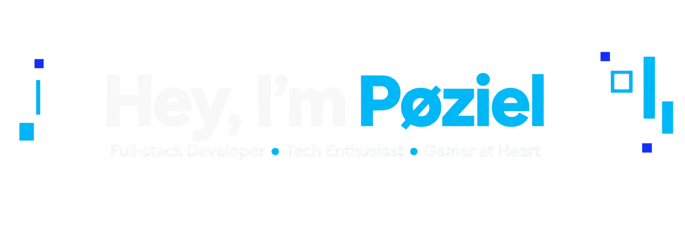
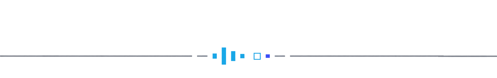

  

  

# About Me

- 🍁 Based in Québec, Canada
- 🔭 I’m currently working as a Full-Stack Developer at [Progi](https://progi.com/en/)
- 🌱 Always learning and polishing my AI knowledges and skills
- 🎨 Infographics and stylish UI design fan
- 🧠 Passionate about productivity and optimization
- 👨‍👩‍👧 Building the **EØGAMING** community and brand
- 🎮 Gamer addicted to innovation and creativity

 

# Recent Projects

<!-- RECENT-PROJECTS:START -->
- [frame](https://github.com/poziel/frame) — A Vue and TypeScript application framework for VS Code-inspired interfaces, with optional host integrations and feature backends.
- [frame-server](https://github.com/poziel/frame-server) — Host-independent terminal and AI agent execution packages for Frame applications
- [pixen](https://github.com/poziel/pixen) — A desktop pixel-art editor with animation, AI-assisted drawing, and scriptable exports to images, animations, Aseprite, and Pixelorama.
- [pozieldotcom-lite](https://github.com/poziel/pozieldotcom-lite) — A lightweight personal landing page for poziel.com, featuring my projects and social links while the full website is in development.
- [reflet](https://github.com/poziel/reflet) — A Windows desktop app for organizing cloud backup destinations and running on-demand Google Drive uploads, powered by Rust, Tauri, and rclone.
<!-- RECENT-PROJECTS:END -->

 

# Tech Stack

  

 

# Where To Find Me

  
  
  
  

